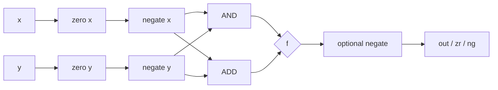

# Logic notes

De Morgan verification

| x | y | x AND y | NOT(x AND y) | NOT x | NOT y | (NOT x) OR (NOT y) |
|---:|---:|---:|---:|---:|---:|---:|
| 0 | 0 | 0 | 1 | 1 | 1 | 1 |
| 0 | 1 | 0 | 1 | 1 | 0 | 1 |
| 1 | 0 | 0 | 1 | 0 | 1 | 1 |
| 1 | 1 | 1 | 0 | 0 | 0 | 0 |

The last two result columns are identical, so `NOT(x AND y) = (NOT x) OR (NOT y)`.

ALU subtraction

For `zx=0, nx=1, zy=0, ny=0, f=1, no=1`:

1. `x` becomes `NOT x`; `y` is unchanged.
2. The adder produces `(NOT x) + y`.
3. Output negation gives `NOT((NOT x) + y)`.
4. In 16-bit two's complement, this is `x - y`.

ALU signal path

