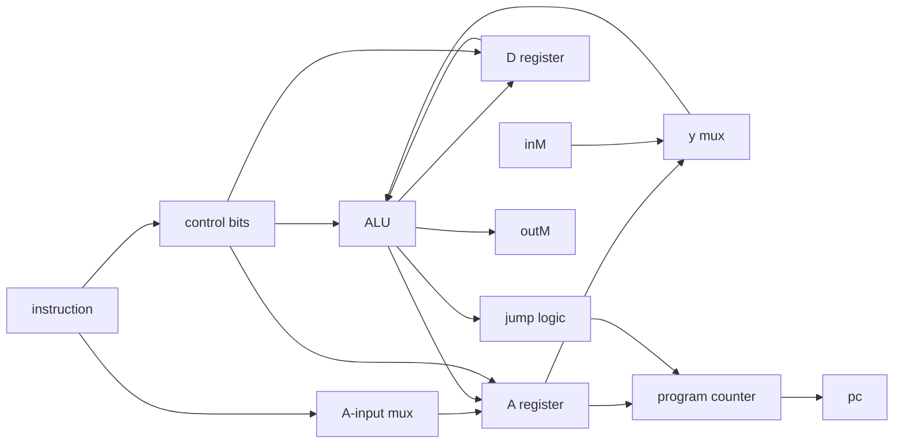

# Hack CPU design

Control equations

| Signal | Logic |
|---|---|
| `loadA` | `NOT i15 OR (i15 AND i5)` |
| `loadD` | `i15 AND i4` |
| `writeM` | `i15 AND i3` |
| `positive` | `NOT zr AND NOT ng` |
| `loadPC` | `i15 AND ((i0 AND positive) OR (i1 AND zr) OR (i2 AND ng))` |

Symbol map

| Symbol | Role |
|---|---|
| `A`, `D` | CPU registers |
| `ALU` | arithmetic and logic result |
| `i15` | A/C instruction selector |
| `i12` | A/M input selector |
| `i11..i6` | ALU control bits |
| `i5..i3` | destination bits |
| `i2..i0` | jump bits |
| `PC` | next instruction address |

Memory map

| Address range | Device |
|---|---|
| `0x0000–0x3FFF` | RAM16K |
| `0x4000–0x5FFF` | Screen |
| `0x6000` | Keyboard |
